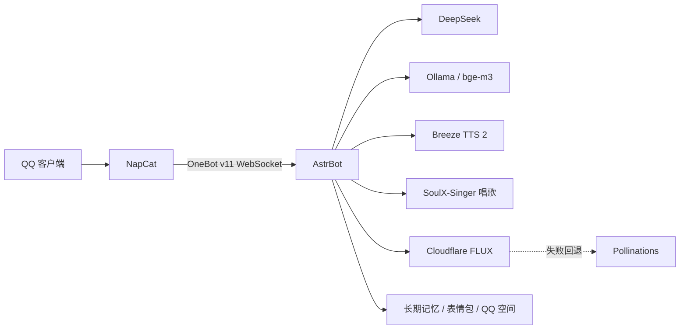

# 大肥鱼 QQ 机器人（脱敏公开版）

AstrBot + NapCat + DeepSeek 的 Windows QQ 机器人配置与脚本。

这个仓库是从本机运行目录整理出来的**脱敏版本**，只保留可分享的配置、人格、插件代码和启动脚本。

[](https://github.com/linjunxin222/dafeiyu-QQ-bot/actions/workflows/ci.yml)
[](LICENSE)
[](https://www.python.org/)

## 不包含的内容

为了安全，以下内容没有上传：

- DeepSeek / 豆包 API Key、Cloudflare Account ID / API Token
- 机器人 QQ 号、主人 QQ 号
- AstrBot 后台账号和密码
- OneBot / NapCat 的 token
- 聊天记录、长期记忆数据库、日志
- 语音试听、声音参考等个人音频
- AstrBot 虚拟环境、NapCat/QQ 运行文件、Ollama 模型
- 表情包二进制资源

这些文件需要在使用者本机重新创建，或通过 AstrBot 后台配置。

## 功能

- DeepSeek 对话，支持文字和图片输入
- QQ 私聊，只允许指定主人
- 长期记忆（本机 Ollama + bge-m3）：召回 6 条、最近 3 条，关闭自动衰减和自动清理；支持主动 `memorize_long_term_memory` 记录重要事实
- Breeze TTS 2 本机语音：标准普通话、十六七岁少女音，音色 `dafeiyu`，约五条回复一条语音，每次只发一条完整语音
- 唱歌：本机 SoulX-Singer 按谱唱，支持《小星星》《两只老虎》《生日快乐》，约 10–30 秒
- 生图：Cloudflare Workers AI `FLUX.1 schnell` 为主，失败自动回退 Pollinations；默认二次元、8 步、1024px
- 表情包、QQ 空间、个性签名工具
- 图片识别最长边 2048px；视频消息抽取最多 6 帧关键画面后交给视觉模型
- 启动器 + 看门狗：Breeze/SoulX/AstrBot/NapCat 并行启动，控制台隐藏，开机自启；启动互斥和单实例保护，异常退出自动恢复
- 电脑/文件/终端/浏览器能力默认关闭

## 架构



## 目录

```text
.
├─ start-bot.ps1                 # 后台启动 Breeze/SoulX + AstrBot + NapCat，并启动看门狗
├─ watch-bot.ps1                 # 看门狗，自动恢复 AstrBot / NapCat / Ollama / Breeze / SoulX
├─ 启动机器人.bat                # 调用 start-bot.ps1 的入口
├─ 使用说明.txt
├─ qr.html                       # 本机 QQ 扫码登录页
├─ persona/大肥鱼.md            # 人设
├─ settings/pack.json           # 脱敏后的导入清单
├─ plugins/                      # 自定义 AstrBot 插件
│  ├─ astrbot_plugin_dafeiyu_imagegen/  # 生图插件
│  └─ astrbot_plugin_dafeiyu_sing/      # 唱歌插件
├─ tools/import_dafeiyu.py       # 配置导入工具
├─ tools/breeze/                 # Breeze 安装/做声音工具
├─ 回答.example.json             # 回答文件模板，复制为 回答.json 后填写
├─ 图片API.txt.example           # Cloudflare 生图凭证模板
├─ 装Breeze语音.bat / 做声音.bat / 导入大肥鱼.bat
├─ docs/SETUP.md                 # 安装步骤
├─ patches/                      # 媒体识别所需的 AstrBot 侧改动说明
├─ PACK_README.md                # 配置包说明
├─ SECURITY.md                   # 安全策略
├─ CONTRIBUTING.md               # 贡献说明
├─ CHANGELOG.md
└─ LICENSE
```

## 仓库自检

提交前可以运行：

```bash
python tools/check_repo.py
```

它会检查 Python 语法、JSON、插件 metadata、是否误提交密钥/日志/音频/记忆库等。GitHub Actions 也会在 push 和 PR 时跑同样的检查。

## 快速开始

完整步骤见 [docs/SETUP.md](docs/SETUP.md)。最短流程：

1. 安装 AstrBot 4.29.3，放在 `AstrBot/app`，虚拟环境放在 `AstrBot/venv`。
2. 安装 NapCat 9.9.33-52230，放在 `NapCat/NapCat.52230.Shell`。
3. 从同版本 QQNT 安装目录复制 `QQEX.exe` 到 NapCat Shell 根目录。
4. 安装 Ollama，拉取 `bge-m3`，设置 `OLLAMA_MODELS` 和 CPU 模式。
5. 安装 Breeze TTS 2（见 `PACK_README.md` 的「本机语音 Breeze」），做好音色 `dafeiyu`。
6. 可选：安装 SoulX-Singer 唱歌服务（见 `plugins/astrbot_plugin_dafeiyu_sing/README.md`，N 卡 6 GB 以上，模型约 2.8 GB）。
7. 在本机创建密钥文件，不要把密钥提交到仓库。
8. 复制 `回答.example.json` 为 `回答.json`，默认 `voice` 是 `4`（Breeze）；填写本机文件路径。
9. 运行 `python tools/import_dafeiyu.py`。
10. 可选：复制 `图片API.txt.example` 为 `图片API.txt`，填 Cloudflare Account ID 和 Workers AI Token。
11. 双击 `启动机器人.bat`，按提示扫码登录 QQ。

## 生图

`astrbot_plugin_dafeiyu_imagegen` 提供两个入口：

- 正常聊天里说「画一张……」「给我生一张图」，模型调用 `generate_image`
- 兜底命令：`/生图 一只蓝鲸女仆`

Cloudflare Workers AI 的免费额度是每天 10,000 Neurons；失败或没配置凭证时会自动回退 Pollinations。免费 FLUX 偶尔会有手部、眼睛小瑕疵，要商用稳定度需要换更强的付费模型。

生图凭证放在 `图片API.txt`，已被 `.gitignore` 排除，**不要提交**：

```text
account_id=你的 Cloudflare Account ID
api_token=你的 Workers AI Token
```

## 安全说明

- 这是公开仓库，**绝对不要**把真实 Key、QQ 号、后台密码、Cookie、Cloudflare Token 或聊天记录提交上来。
- `start-bot.ps1` 和 `watch-bot.ps1` 使用相对路径，默认从脚本所在目录启动。
- 机器人默认只允许管理员私聊；群聊和其他 QQ 会被拦截。
- 电脑操作、文件、终端、浏览器工具仍然关闭。

## 媒体识别

图片和 QQ 表情包会作为图片输入交给视觉模型。视频会由 ffmpeg 抽取关键帧并拼成一张图，再交给视觉模型；不会上传完整视频，也不识别视频声音。

媒体支持需要 AstrBot 侧的两个小改动，见 [patches/README.md](patches/README.md)。整条语音补丁见 [patches/tts_whole_reply.diff](patches/tts_whole_reply.diff)。

## 许可

配置包部分沿用原仓库的 MIT License，见 `LICENSE`。AstrBot、NapCat、QQ、Ollama、Breeze 和豆包服务分别遵循它们自己的许可与服务条款。Breeze 模型只允许研究和非商业使用。
